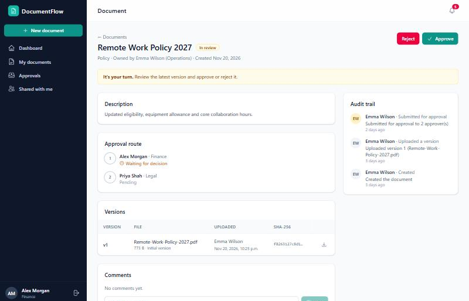
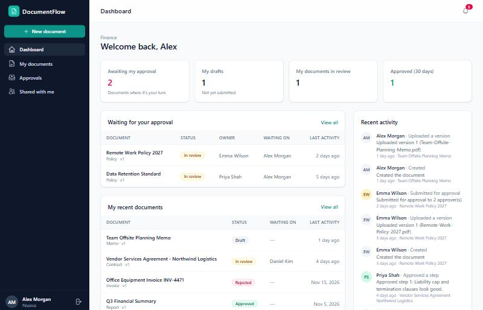
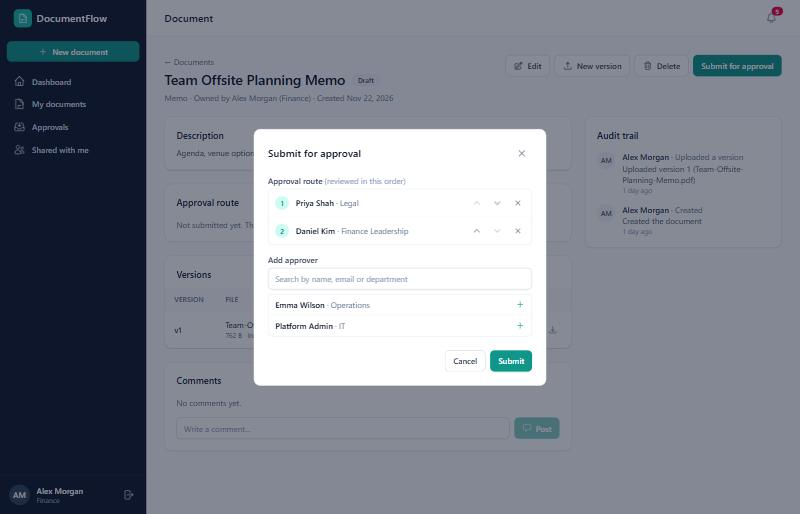
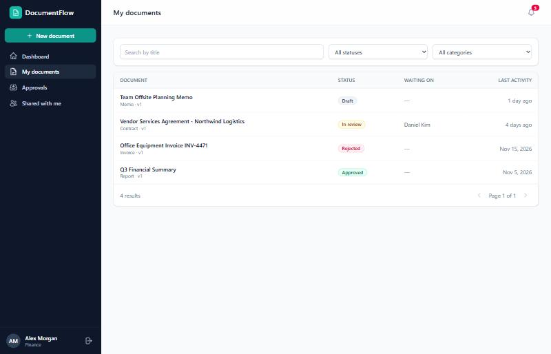
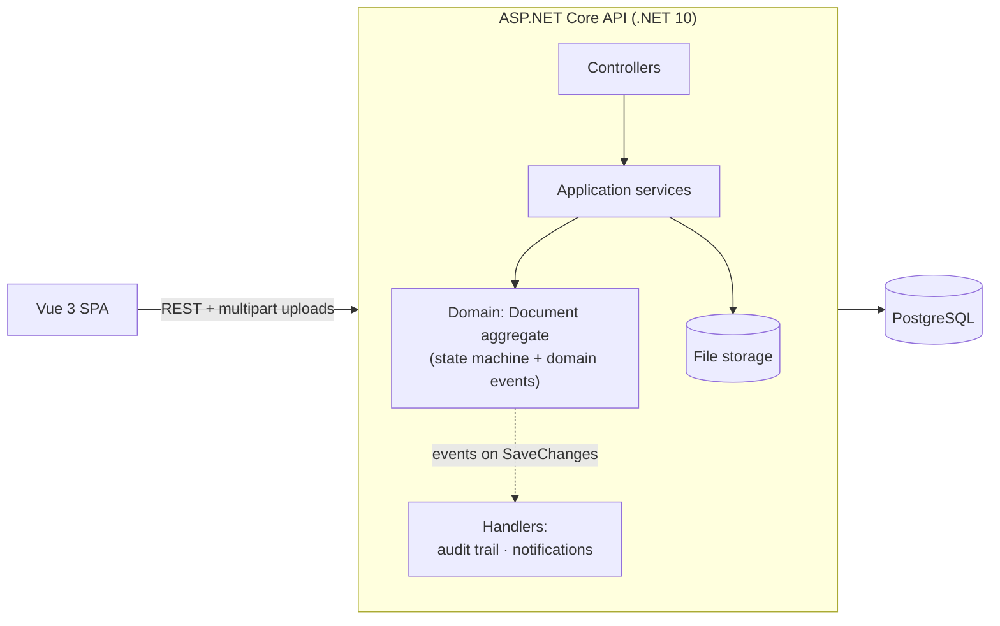

# DocumentFlow — Document Approval & Audit Platform

[](https://github.com/Samgar-kz/DocumentFlow/actions/workflows/ci.yml)


DocumentFlow is an enterprise document management system: teams upload contracts, invoices and policies,
route them through **sequential multi-step approvals**, and keep a **complete, append-only audit trail** of
every action. It is modelled on the electronic document workflows I built in banking, where every decision
must be attributable, ordered and provable.



## Features

- **Documents and versions** — upload PDF, Office, image, text or CSV files; every revision is kept with its SHA-256 hash, uploader and change note.
- **Sequential approval routes** — the owner picks up to five approvers in order; each one approves or rejects in turn. Rejections require a reason, and a new version reopens the document for resubmission.
- **Workflow state machine** — `Draft → In review → Approved / Rejected`, with withdraw-and-revise. Approved documents are final.
- **Audit trail** — creation, uploads, downloads, submissions, each approval, rejections, comments, deletions and role changes are recorded with actor and timestamp, and remain after a draft is deleted.
- **Notifications** — in-app notifications when it's your turn, when your document is approved or rejected, and on new comments.
- **Permissions** — documents are visible only to their owner, their approvers and administrators; the API returns the actions the caller may take, so the UI never re-implements the rules.
- **Administration** — organisation-wide audit log with filters, and user role management.
- **Demo organisation** — five users and seven documents in every workflow state, created through the real domain model.

| Dashboard | Approval route | My documents |
| --- | --- | --- |
|  |  |  |

## Quick start

```bash
docker compose up --build
```

| What | URL |
| --- | --- |
| Web app | http://localhost:8081 |
| API reference (Scalar / OpenAPI) | http://localhost:5090/scalar |

Sign in as **demo@documentflow.dev / Demo123!** — two documents are waiting for your approval. Other demo users
(`priya@`, `daniel@`, `emma@documentflow.dev`, same password) let you play the other side of a workflow;
**admin@documentflow.dev / Admin123!** opens the audit log. These accounts exist only because the local compose file enables demo seeding.

<details>
<summary><strong>Run without Docker</strong></summary>

Prerequisites: .NET 10 SDK, Node.js 24+, PostgreSQL 17 with a `documentflow` database owned by `documentflow` / `documentflow`.

```bash
dotnet run --project backend/src/DocumentFlow.Api      # http://localhost:5090, migrates and seeds in Development
cd frontend && npm install && npm run dev               # http://localhost:5173, proxies /api to the backend
```
</details>

## Architecture



The backend uses the same four-layer structure as my other projects (`Domain`, `Application`, `Infrastructure`, `Api`).

### Design decisions

- **Rich aggregate with an explicit state machine.** `Document` owns its versions, approval steps and comments. Every transition (`Submit`, `Approve`, `Reject`, `Withdraw`, `AddVersion`) validates the current state and the actor, so invalid workflows cannot be expressed — they are unit-tested without a database.
- **Domain events → audit trail and notifications in one transaction.** Aggregates raise events such as `StepApproved` or `DocumentRejected`. The EF Core context dispatches them to handlers inside `SaveChanges`, so an approval, its audit entry and the next approver's notification are committed atomically — no "approved but not audited" state is possible.
- **An audit log that survives deletion.** Audit entries have no foreign key to documents and copy the title, so deleting a draft never erases its history. Downloads are audited too.
- **Upload hardening.** Files are checked against an allow-list of extensions *and* their magic bytes (a renamed `.exe` is rejected), the content type is derived server-side, file names are sanitised, storage keys are generated by the server and every resolved path is verified to stay inside the storage root. Each version stores a SHA-256 hash.
- **Least-privilege visibility.** Non-participants get `404` (not `403`) so document existence isn't leaked; participants attempting an action that isn't theirs get `403`; invalid state transitions return `422`.
- **Optimistic concurrency.** The document row uses PostgreSQL's `xmin` as a concurrency token, so two simultaneous decisions on the same step cannot both succeed.
- **Pluggable storage.** `IFileStorage` has a local-disk implementation (a Docker volume) and can be replaced with Azure Blob Storage or S3 without touching the application layer.

## API overview

| Method | Endpoint | Description |
| --- | --- | --- |
| `GET` | `/api/documents?scope=Mine\|AwaitingMe\|Involved\|All` | Search with status/category filters and paging |
| `POST` | `/api/documents` | Create a draft with its first file (multipart) |
| `GET` `PUT` `DELETE` | `/api/documents/{id}` | Details with permissions; edit; delete a draft |
| `POST` | `/api/documents/{id}/versions` | Upload a new version (multipart) |
| `GET` | `/api/documents/{id}/versions/{n}/download` | Download a version (audited) |
| `POST` | `/api/documents/{id}/submit`, `/approve`, `/reject`, `/withdraw` | Workflow transitions |
| `POST` | `/api/documents/{id}/comments` | Comment (owner and approvers) |
| `GET` | `/api/documents/{id}/activity` | Audit trail of a document |
| `GET` | `/api/dashboard`, `/api/notifications`, `/api/users` | Workspace |
| `GET` `PUT` | `/api/admin/audit`, `/api/admin/users/{id}/role` | Administration |

## Testing

```bash
dotnet test backend/DocumentFlow.slnx
cd frontend && npm test
```

- **Domain unit tests** cover every workflow transition, route validation, permissions, comments and deletion rules; **file inspection tests** cover magic-byte checks, size limits and file-name sanitisation.
- **Integration tests** run the API against PostgreSQL (Testcontainers) and a temporary file store: a full two-step approval with notifications and audit order, rejection and resubmission, privacy between users, disguised uploads, audited downloads, deletion with a surviving audit trail, comments and the admin area.
- **Front-end tests** (Vitest) cover the HTTP client's token refresh, the auth store and UI helpers.
- **CI** runs all of the above, lints and type-checks the UI, and builds both Docker images.

## Tech stack

| Layer | Technologies |
| --- | --- |
| Backend | C# 14, .NET 10, ASP.NET Core, EF Core 10, Npgsql, FluentValidation, JWT bearer auth with rotating refresh tokens, rate limiting, OpenAPI + Scalar |
| Frontend | Vue 3, TypeScript, Pinia, Vue Router, Tailwind CSS 4, Vite |
| Data | PostgreSQL 17, EF Core migrations, local file storage behind an abstraction |
| Testing | xUnit, WebApplicationFactory, Testcontainers, Vitest, Vue Test Utils |
| DevOps | Docker (multi-stage, non-root), Docker Compose, Nginx, GitHub Actions |

## Roadmap

- Parallel approval steps and delegation while an approver is away
- E-mail and real-time (SignalR) notifications
- PDF preview and e-signature of the approved version
- Retention policies and legal hold

## Author

**Samgar Abdikozha** — .NET / full-stack software engineer. I previously implemented an electronic document management
system connecting a bank with government entities.
[LinkedIn](https://www.linkedin.com/in/samgar-abdikozha/) · [GitHub](https://github.com/Samgar-kz)

Licensed under the [MIT License](LICENSE).
